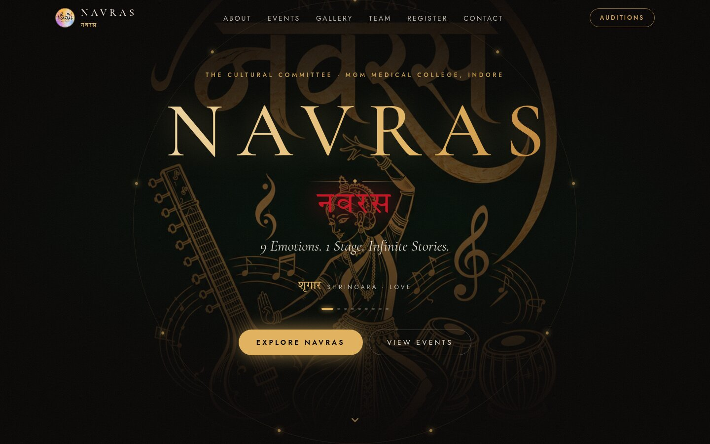
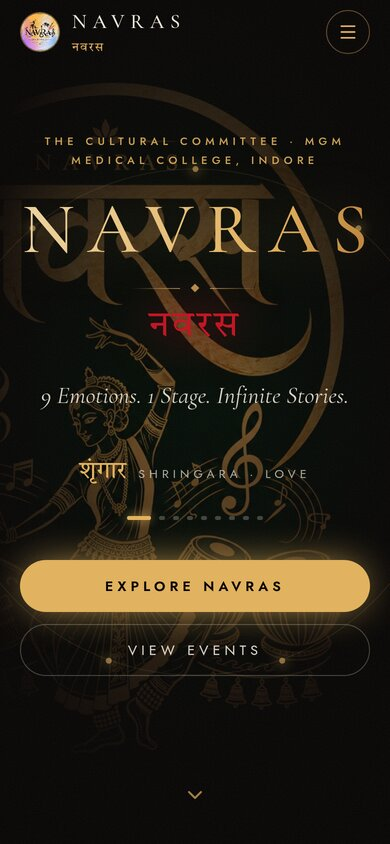
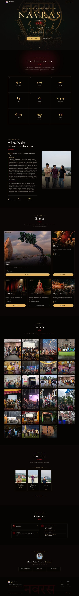

# NAVRAS | नवरस

**9 Emotions. 1 Stage. Infinite Stories.**

The official website of **NAVRAS**, the Cultural Committee of MGM Medical College, Indore, and the heart of the college festival, Nirvana.

<p align="center">
  
  &nbsp;
  
</p>

<details>
<summary><b>See the full page</b></summary>
<br>
<p align="center"></p>
</details>

---

## About the site

It's a single static page: plain HTML, CSS and a small JavaScript file. There is no framework, no build step and no server. It includes:

- **Hero**: the animated NAVRAS title with the nine rasas cycling through
- **The Nine Emotions**: the rasas of the Natyashastra
- **About Us**: the committee's story and mission
- **Events**: event cards with Google Form registration links
- **Gallery**: photos from past fests, with a full-screen viewer (arrow keys work too)
- **Our Team**: the committee heads
- **Contact**: Instagram, phone numbers and address
- **Behind the Website**: the people who made it

## Run it locally

Open `index.html` in a browser. Or, to serve it like a real website:

```bash
python3 -m http.server 8000
# then open http://localhost:8000
```

## Deploy

Upload the folder to any static host: GitHub Pages, Netlify, Vercel, Cloudflare Pages, or plain web hosting.

For **GitHub Pages**, go to **Settings → Pages**, choose **Deploy from a branch**, then pick `main` and `/ (root)`.

## Project structure

```
index.html              The whole page. All text, links and image paths live here.
js/main.js              Menu, rotating rasas, scroll animations, gallery viewer
css/styles.css          Compiled styles (the page uses this file)
css/tailwind-source.css Source for styles.css (only needed when rebuilding, see below)
css/fonts.css           Font definitions
fonts/                  Cormorant Garamond, Jost, Tiro Devanagari Hindi
assets/                 All photos: hero, events, gallery, team, logo
docs/                   Screenshots for this README
```

## Editing the site

Everything is in `index.html`. Each section starts with a comment like `<!-- ===================== GALLERY ===================== -->`, so search for the section name to find it.

| To change… | Do this |
|---|---|
| **Text** | Edit the words directly in `index.html`. |
| **A photo** | Put the new photo in `assets/` and change the `src="assets/..."` path. |
| **Gallery** | Copy one `<li>…</li>` block inside `gallery-grid`, then change the image `src` and the `alt` text (it appears twice). Every 3rd photo uses `aspect-[4/5]` (tall); the rest use `aspect-[4/3]`. |
| **Team photos** | Change the `src` on the head's ``. To show more of the top or bottom of a tall photo, change `object-[center_80%]` (0% = top, 100% = bottom). |
| **Event registration** | Each event card has a **Register** link with a Google Form URL. For an event whose form isn't ready, use the **Opening soon** block from the Fashion Walk card. |
| **Phone numbers / Instagram** | Search the **CONTACT** and **FOOTER** sections. |

> **Tip:** Keep photos under about 1 MB (around 1600 px wide is plenty) so the site loads quickly on phones.

### Rebuilding the CSS (rarely needed)

The site uses [Tailwind CSS](https://tailwindcss.com) classes, compiled into `css/styles.css`. You only need to rebuild if you add a **new** class that isn't already used somewhere on the page. Editing text, images and links never needs a rebuild.

```bash
npm install --no-save tailwindcss@4.3.3 @tailwindcss/cli@4.3.3
npx tailwindcss -i css/tailwind-source.css -o css/styles.css --minify
```

## Credits

### Development team

| | |
|---|---|
| **Harsh Pratap Chandil** | 2024 Batch |
| **Ishant Singh** | IIITM Gwalior |
| **Aditya Verma** | IIST Indore |

### Built with Claude

Converted from the original Next.js app into this static site with **[Claude](https://claude.ai)** by Anthropic, using [Claude Code](https://claude.com/claude-code). Claude rebuilt every section to match the original design pixel for pixel, self-hosted the fonts, rewrote the interactive parts in plain JavaScript, and helped bring in the photos, logo, team portraits and this developer credits section.

---

<p align="center"><i>Made with love for NAVRAS · MGM Medical College, Indore</i></p>
